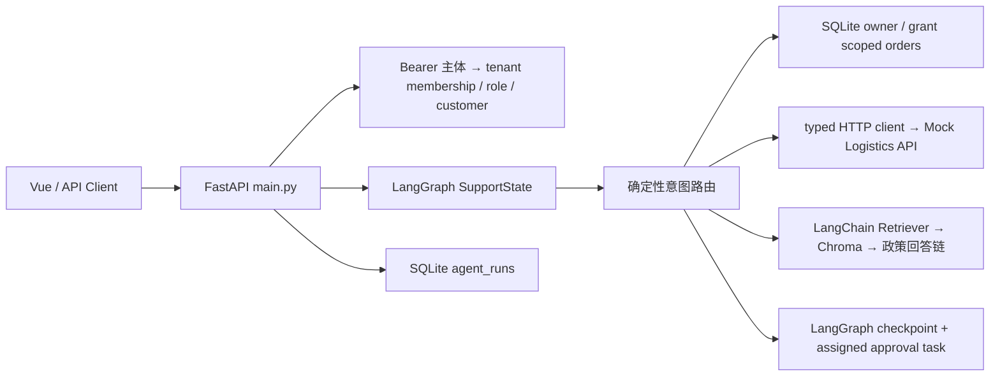
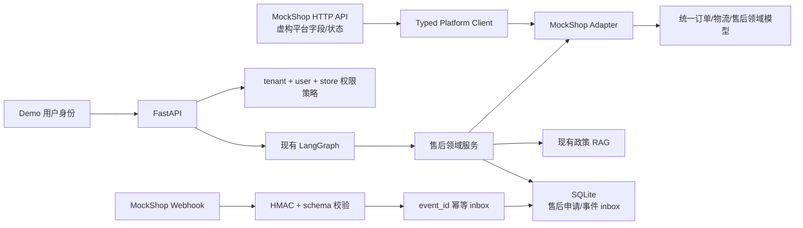

# Enterprise Support Agent V2.1 电商集成架构

更新：2026-11-22。本文描述当前 V2.1 Demo 架构和经证实的运行边界；用户报告的 WSL 验收与本机测试分别标注。

## 当前架构

对应源码：`src/support_agent/main.py`、`auth.py`、`db.py`、`agent/{graph,state,nodes}.py`、`rag/`、`logistics.py` 与 `integrations/`。`POST /chat` 提供确定性路由；Customer 订单查询按 tenant/customer owner 过滤，Service 按 grant 过滤；Approver 仅访问分配任务；Admin 管理操作限制在本租户。退款批准只保存 `approved_demo`，不执行退款。政策链由 LangChain/Chroma 提供证据，但引用编号校验不证明事实受证据蕴含；本地 Demo token 是固定身份选择器。

当前本机全量 pytest：**130 passed / 17.01s**。35/35 路由与 8/8 订单参数是既有的标注评估记录，不是本次重跑。Vue production build 是此前验收结果。用户报告早前冲突处理版本在 WSL 的冲突 smoke、Phase 6、V2.1 verifier 全通过；当前复合查询扩展尚未部署，用户要求等提交后再同步。

## V2.1 电商集成架构（已实现）

Adapter 是平台边界：Agent 和售后服务只使用统一 DTO/方法，不依赖平台 JSON 字段、平台状态码或平台错误文本。MockShop 当前是唯一实现；淘宝、京东、Shopify 仅作为未来扩展点，不接真实 API。

## 复用、扩展与新增

| 处理 | 模块 | 具体做法 |
|---|---|---|
| 直接复用 | FastAPI、DemoIdentity、SQLite helper、LangGraph、RAG、物流 client、Pydantic、pytest、Compose、CI | 保持现有 API 行为和 V1 规则；新业务做旁路增量 |
| 扩展 | SQLite schema、订单 DTO、身份授权判断、Graph State/路由、UI、评估集 | 增加 store/customer scope、售后流程状态和处理过程展示；迁移保持旧数据兼容 |
| 新增 | `integrations/`、独立 MockShop API、售后申请数据与服务、Webhook 验签/幂等记录、对应文档 | 所有固定数据标成 fictional/demo；所有创建动作仅写入 demo 售后申请，不代表平台执行 |

## V2.1 实施阶段与验收

1. **Phase 0 现状盘点：完成。** 复用现有 V2，增量添加模拟电商 Adapter。
2. **Phase 1–5 API、Adapter、权限、售后、Agent、Webhook：完成。** 固定虚构服务与数据；退款/售后流程不会执行真实写回。
3. **Phase 6 UI、评估与文档：完成。** Vue、API/评估/面试材料和 CI 已实现；OOS-v1 是开发回归集，不再声称为 blind holdout。
4. **Phase 7 Compose/CI/部署：完成。** 2026-11-23 WSL 实际验收三容器健康、Phase 6 与 V2.1 verifier 通过；持久 SQLite 在线备份后迁移至 `user_version=1`，并核验完整性及店铺范围复合主键。后续更新脚本保留只读 schema 后置核验。

## 后续工程可靠性状态

- **权限 Phase 2：完成。** Customer owner、Service grants、Approver assigned task/self-approval guard、Admin tenant scope，用户报告 WSL 验收通过。
- **评估 Phase 3：完成。** OOS-v1 的 OOS-05 引导了定制商品/质量/运费查询扩展；距离校准不支持单一阈值；直接冲突保护只覆盖句面极性反转。用户确认 OOS-v2 分诊；当前已观察回归报告的检索、答案要点、拒答要点、引用来源规则筛查均通过，但不代表语义准确率或盲测成绩。用户已授权同一配置模型评估，HOLDOUT-04 是已知风险案例。
- **OOS 审计后续：本机完成，WSL 验收待做。** 已新增逐案例答案和证据归档。人工检查发现 HOLDOUT-07 旧回答对 POL-06 明确规定的法定节假日计数先拒答后肯定，已添加窄范围直接答案与筛查回归；完整 OOS-v2 回归筛查通过。修复部署后再更新阶段状态。
- **迁移 Phase 5：完成。** WSL 更新脚本会在现有业务验收前，以只读方式核对 SQLite 完整性、代码 schema version 与复合身份键；CI 同时检查 shell 语法。
- **保护范围：**冲突规则不覆盖语义改写式矛盾、隐含冲突或一般证据蕴含。证据内指令风险仍未通过真实模型做安全验证，不应宣传为已防护。

## 最小可交付版本（MVP）

一个 MockShop；虚构店铺、用户和固定订单覆盖待发货、已发货、已签收、已申请售后、已退款；经 Adapter 查询订单/物流；有明确标注的售后资格规则；符合条件时产生 `pending_demo` 售后申请 ID；Agent 能串起订单验证、政策 RAG、资格检查和申请；Webhook 有签名与幂等；用户/租户/店铺隔离测试全部通过；Compose 可启动且 README/API 文档可跟跑。

本 MVP 不包含真实平台授权、真实客户信息、真实退款或平台写回、真实生产身份、Redis/Kafka、多平台实现，也不承诺生产级安全或可靠性。

## 关键风险与约束

- **旧数据兼容**：未知所有权的旧订单默认拒绝访问；旧售后审计列为 NULL 时保留未知语义，幂等重试不猜测或回填。用户报告增量迁移已在备份后完成。
- **写操作语义**：售后申请不是审批、更不是退款完成。API 和 Agent 文案须明确状态，并且只有获得业务权限和用户确认才创建 demo 申请。
- **Webhook**：HMAC 必须对原始 body 计算并常量时间比较；event_id 唯一键负责重放保护；坏事件不能部分更新业务数据。
- **平台异常**：Adapter 统一映射 timeout、404、无权限和无效 JSON；日志只记录 trace/platform/event metadata，不能记录 token/签名或完整私密载荷。
- **部署环境**：现有运行实例位于 WSL `/opt/project2`，容器占用 8000；只在离线验证完成后按既定 WSL 流程发布并由用户验收。
- **RAG grounding**：当前引用检查只验证编号属于本次证据；无关证据、互相冲突的证据和 prompt-like 证据内容需要进一步定义处理策略。自动标签不能冒充人工根因或事实准确率。

