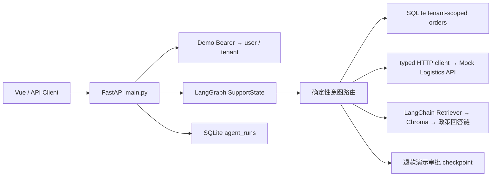
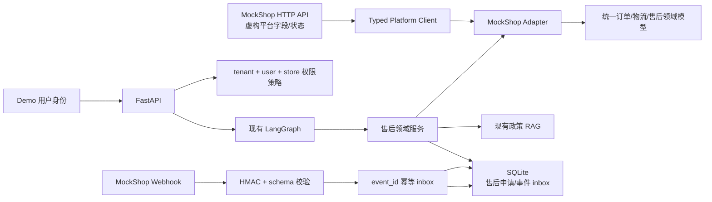

# Enterprise Support Agent V2.1 电商集成架构

更新：2026-11-18。当前实现与计划新增能力分开标记；未完成项不代表已经上线。

## 当前 V2 架构（Phase 0 实测源码）

对应源码：`src/support_agent/main.py`、`auth.py`、`db.py`、`agent/{graph,state,nodes}.py`、`rag/`、`logistics.py` 与 `mock_logistics.py`。现有 `POST /chat` 提供确定性路由；订单查询只读并按 tenant_id 过滤；退款审批只保存 `approved_demo` 状态，不执行退款；政策链通过 LangChain/Chroma 检索证据；本地 Demo token 是固定身份选择器。

当前 pytest 基线：**71 passed**（2026-11-18，本机 `.venv`）；当前全量结果 **93 passed**（12.26 秒）。原 35 条明确路由标签评估为 **35/35**，订单参数 **8/8**（Webhook/店铺身份补齐后未重跑这项评估）。Vue production build 通过。Compose 静态与 WSL runtime 验收仍待本阶段完成。

## V2.1 电商集成目标架构

Adapter 是平台边界：Agent 和售后服务只使用统一 DTO/方法，不依赖平台 JSON 字段、平台状态码或平台错误文本。MockShop 当前是唯一实现；淘宝、京东、Shopify 仅作为未来扩展点，不接真实 API。

## 复用、扩展与新增

| 处理 | 模块 | 具体做法 |
|---|---|---|
| 直接复用 | FastAPI、DemoIdentity、SQLite helper、LangGraph、RAG、物流 client、Pydantic、pytest、Compose、CI | 保持现有 API 行为和 V1 规则；新业务做旁路增量 |
| 扩展 | SQLite schema、订单 DTO、身份授权判断、Graph State/路由、UI、评估集 | 增加 store/customer scope、售后流程状态和处理过程展示；迁移保持旧数据兼容 |
| 新增 | `integrations/`、独立 MockShop API、售后申请数据与服务、Webhook 验签/幂等记录、对应文档 | 所有固定数据标成 fictional/demo；所有创建动作仅写入 demo 售后申请，不代表平台执行 |

## 实施顺序与验收

1. **Phase 0 现状盘点：完成。** 基线 71 passed；源代码确认此前没有平台 Adapter、售后资格接口、售后申请 API 或 Webhook。
2. **Phase 1 Mock API 与领域契约：本机实现完成。** 固定虚构订单/物流/售后 API、请求/响应模型与测试已落地；Compose 文件已配置 mock-shop 服务，容器联调待 WSL 验收。
3. **Phase 2 Adapter 与权限：本机实现完成。** Protocol、registry、typed client、状态映射、异常归一、Demo 身份到店铺/客户授权及 A/B 两店铺隔离测试已实现。
4. **Phase 3 售后资格与申请：本机实现完成。** REST/SQLite 幂等申请、请求人身份和显式确认已实现；只产生 `pending_demo`，资格规则为明确标记的 MockShop 规则。
5. **Phase 4 Agent 集成：本机实现完成。** 确定性路由通过与 DemoIdentity 绑定的 LangChain StructuredTools 查询订单、物流与资格；售后资格路径串联 RAG；模型不执行写操作。
6. **Phase 5 Webhook：本机实现完成。** HMAC raw-body 验签、Pydantic 校验、event_id 幂等、冲突拒绝、过期事件防覆盖及 tenant-scoped 状态读取均有测试。
7. **Phase 6 UI/评估/文档：本机完成待验收。** Vue 展示平台订单/物流/资格并提供先检资格、再明确确认创建演示申请的操作；本机全量测试 93 passed、Vue build 通过。API/Evaluation/Interview 文档与 CI 尚需最后核对。
8. **Phase 7 Compose/CI/部署：进行中。** 先跑 Compose 静态配置、完整文档与 CI 检查；然后整理 WSL 同步文件和验收步骤，提醒用户在 `/opt/project2` 更新容器。禁止在 Windows checkout 启动 Compose 抢占 8000。

## 最小可交付版本（MVP）

一个 MockShop；虚构店铺、用户和固定订单覆盖待发货、已发货、已签收、已申请售后、已退款；经 Adapter 查询订单/物流；有明确标注的售后资格规则；符合条件时产生 `pending_demo` 售后申请 ID；Agent 能串起订单验证、政策 RAG、资格检查和申请；Webhook 有签名与幂等；用户/租户/店铺隔离测试全部通过；Compose 可启动且 README/API 文档可跟跑。

本 MVP 不包含真实平台授权、真实客户信息、真实退款或平台写回、真实生产身份、Redis/Kafka、多平台实现，也不承诺生产级安全或可靠性。

## 关键风险与约束

- **旧数据兼容**：当前 V2 按 tenant_id 隔离，没有 user/store 关系。须明确映射，不可默认 `tenant_id == store_id`；SQLite schema 增量迁移需可重入。
- **写操作语义**：售后申请不是审批、更不是退款完成。API 和 Agent 文案须明确状态，并且只有获得业务权限和用户确认才创建 demo 申请。
- **Webhook**：HMAC 必须对原始 body 计算并常量时间比较；event_id 唯一键负责重放保护；坏事件不能部分更新业务数据。
- **平台异常**：Adapter 统一映射 timeout、404、无权限和无效 JSON；日志只记录 trace/platform/event metadata，不能记录 token/签名或完整私密载荷。
- **部署环境**：现有运行实例位于 WSL `/opt/project2`，容器占用 8000；只在离线验证完成后按既定 WSL 流程发布并由用户验收。

