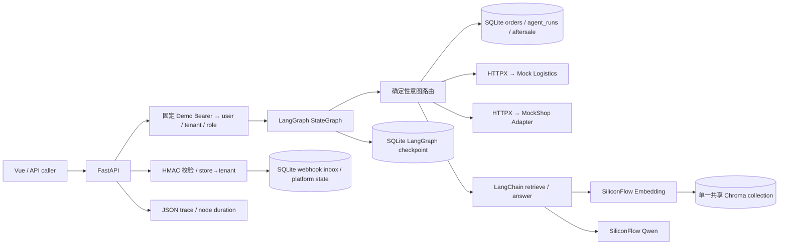

# 工程质量与开源竞争力审计

审计日期：2026-11-22
范围：当前 Windows 工作区源码、测试、评估数据、README/架构材料、Docker/Compose/CI 配置，以及用户报告的 WSL 运行验收。
限制：本轮只读检查；只新增审计和项目计划文档，没有修改业务实现、数据库、向量库或 Docker 服务。

## 总结

项目已具备可运行的售后 Agent Demo：FastAPI 承接固定演示身份，LangGraph 确定性路由到 SQLite 订单、政策 RAG、模拟物流、MockShop 及暂停恢复的演示审批；pytest、GitHub Actions 和 Compose 覆盖多条端到端路径。当前证据支持“功能模块和演示链路可复现”，不支持“生产级认证/授权”或“RAG 事实正确率已被自动证明”。

本机会话复跑全量测试：**105 passed / 17.99s**。GitHub 公开 `main` 当前为 `43adc60`，最近 Actions run 29 在 2026-11-18 成功；当前本地工作树有未提交的 OOS 改进，所以远端成功不能算作本地未提交变更的 CI 验证。用户报告新版 WSL 三容器 healthy，`verify_phase6` 和 `verify_v21` 全通过；该运行结果为用户提供的证据。

## 当前架构

主要入口：`src/support_agent/main.py`、`auth.py`、`db.py`、`agent/{state,graph,nodes}.py`、`rag/`、`integrations/`、`observability.py`。三个 Compose 服务是 `support-agent`、`mock-shop`、`mock-logistics`；政策问答使用配置的真实 SiliconFlow API，订单与外部业务平台数据是虚构/Mock。

## 核验矩阵

| 模块 | 状态 | 代码/测试证据与边界 |
|---|---|---|
| API 身份 | 已实现且有测试（Demo 范围） | `auth.py::require_demo_identity` 从 Bearer 映射固定 user/tenant/role。`tests/test_api.py` 覆盖缺失/无效令牌和伪造 `X-Tenant-ID`。这是公开演示身份选择器，不是真实认证。 |
| SQLite 订单权限 | 部分实现 | `db.py::fetch_order` 的 SQL 条件是 `order_id + tenant_id`，`orders` 没有 owner/user 权限映射。`test_order_is_returned_only_for_matching_tenant` 只证明跨租户拒绝，未证明同租户不同请求人隔离。请求人/审批人属于同一租户，后者能读该租户的全部普通订单。 |
| MockShop 用户/店铺隔离 | 已实现且有测试（固定映射） | `integrations/permissions.py::can_access_order` 按 tenant、store、customer 映射；`tests/test_ecommerce_api.py::test_ecommerce_order_and_logistics_are_identity_scoped` 覆盖自有、同租户其他客户、跨店铺及 approver。当前 API/Tool 先调用 `adapter.get_order()` 取得订单，再执行 `can_access_order`；权限检查在数据读取之后，真实外部适配器复用时需重新设计边界。 |
| Agent run 读取 | 部分实现 | 表同时存 `user_id` 与 `tenant_id`，但 `fetch_agent_run` 和 `GET /agent-runs/{run_id}` 仅按 run_id + tenant 查询；没有同租户不同用户读取测试。运行记录不含原始问题，当前泄露面较小，但授权规则不完整。 |
| 人工审批 / checkpoint | 已实现且有测试（Demo 范围） | `main.py::_approval_snapshot` 校验 tenant；LangGraph SQLite checkpoint 支持暂停、重启恢复；测试覆盖 approver 角色、自批拒绝、重复决定冲突和跨重启恢复。状态查看对同租户身份可用，决定要求 approver 且禁止发起人自批；没有单独的持久审批决策审计表。 |
| LangGraph State / Node / Edge | 已实现且有测试 | `SupportState`、`build_support_graph`、节点及 Conditional Edge 均有明确代码；当前图为有界 DAG，没有回边。路由用正则和关键词，35/35 是历史已标注路由评估，不是本轮重跑结果，也不代表任意自然语言。 |
| RAG 证据与安全降级 | 部分实现且有测试 | Chroma 返回 source_id/title/content/distance；空检索不调用模型，Embedding/LLM 异常安全降级，回答引用编号需属于本次 evidence。引用 ID 校验不证明句子受证据蕴含。没有 score threshold、无关召回拒答、政策冲突识别或自动事实蕴含测试。 |
| RAG 多租户 | 当前 Demo 使用共享公开政策；不支持租户私有知识隔离 | `open_policy_store` 使用单一 collection，文档没有 tenant filter。当前仅存演示政策，不构成现有敏感数据泄漏；若未来加入租户私有文档，必须先设计 collection/metadata 隔离和越权测试。 |
| RAG 数据/指标 | 开发集与 OOS 文件分离；OOS 的盲测独立性已失效 | `data/evaluation/v1_eval_cases.json` 有 45 条、36 条带 evidence 标签；原文件未修改。`data/evaluation/oos/rag_oos_v1.json` 有 15 条，但已用于本轮 Prompt/约束和检查规则调整，应视为开发/回归集，不再作为未见盲测集。OOS 当前报表有 Hit@4、Macro Recall@4、规则项通过率、拒答检查、引用编号匹配；缺少 Micro Recall、Precision、Faithfulness/无依据生成率及业务流程总体指标。规则项不是语义准确率。 |
| Bad Case 闭环 | 部分实现 | `tests/oos/runner.py` 可自动标记 RETRIEVAL、GENERATION、ABSTENTION、BUSINESS 和无效引用；未提供完整标准字段来记录 DATA/CHUNK/PERMISSION/ROUTING 根因、根因复核者、修复方案及回归结果。自动化只给可能原因，不应直接当作根因。 |
| Webhook | 已实现且有测试 | raw body HMAC + compare_digest，tenant 从签名事件中的可信 store 映射派生；事件唯一键、冲突/重复/stale 测试在 `tests/test_webhooks.py`。`platform_order_states` 主键为 `(platform, order_id)`，若未来平台订单编号只在店铺内唯一，租户之间编号冲突会互相覆盖；固定 Mock fixtures 未覆盖该情况。 |
| SQLite schema 演进 | 部分实现 | `db.py` 用 `CREATE TABLE IF NOT EXISTS` 初始化，没有 schema version/迁移器或 ALTER migration 测试。对当前初始化数据可重复；持久数据结构改变后如何升级尚无可复现路径。本轮未改库。 |
| 日志/追踪 | 已实现基础版本 | trace_id、HTTP 与 Graph 节点、节点耗时、路由、检索 source、异常类型和输入脱敏有实现及测试。`JsonFormatter` 只输出白名单字段，工具事件的 tool/user_role 等 extra 不会进入最终日志；没有独立模型调用耗时、P50/P95 或并发性能测试。 |
| Pytest | 已实现且有本机证据 | 本机全量 **105 passed / 17.99s**。多租户/MockShop/API/RAG/Webhook/审批覆盖较广；部分真实外部服务被 fake/Mock 替代。不得把这些单测说成真实供应商或生产验证。 |
| GitHub Actions | 配置完整且远端有成功记录 | `.github/workflows/tests.yml` 包括 Python 3.12、locked pytest、Vue build、Compose config、Docker build、no-key 容器 smoke。公开仓库最新 run 29 / SHA `43adc60` 为 success；本地 OOS 未提交改动没有被该 run 测到。 |
| Docker Compose / WSL | 已实现且有用户报告的运行证据 | 三服务 healthcheck、D 盘数据 bind mount、错误路径拒绝静默创建。用户报告最新 WSL 三容器重建后 healthy，阶段 6 和 V2.1 verifier 全 PASS。当前审计未启动或修改容器。 |
| README / 架构材料 | 内容存在但部分过期 | README 的验证摘要仍写 V2.1 未同步/93 tests；`ARCHITECTURE.md` 顶部阶段状态停留在 11-18 的“进行中”。与最新 11-21/22 测试和用户 WSL 验收不一致；后续展示阶段应统一更新。 |

## 问题优先级与建议

### P0：进入核心业务修复前需确认的设计

1. **订单、运行记录和审批查询缺少一致的用户级授权模型。** 现有 SQL 是租户过滤，MockShop 则采用请求人 customer 映射、审批人店铺范围。建议先明确“请求人只看自有订单与 run；审批人可看哪些请求/订单”，再确定订单所有权表/映射和回归测试。涉及 schema 与既有 D 盘数据演进，需先获得用户确认。
2. **MockShop 权限检查晚于订单读取。** 为便于隐藏跨客户订单，API 对外仍回 404，但适配器已先拿到 provider 订单对象。建议把可授权 scope 传至服务查询，或先在可信权限目录核验订单归属再读完整对象；这是外部平台 Adapter 将来可复用的必要边界。
3. **RAG 只验证引用编号匹配，没有事实级 grounding。** 当前空 evidence/请求失败处理是安全的，但任意非空 Top-4 会进入生成。建议先补离线测试（无关召回、冲突证据、用户注入、证据矛盾），再由用户确认是否增加最小相关性门槛/拒答规则；不要先直接改 Prompt。
4. **当前 15 条 OOS 已被用于调优。** 其文件独立，但使用过程不再 blind；现有分数更适合作为 OOS-v1 回归结果。建议冻结为回归集，另建未用于开发的 holdout-v2，并由用户审核问题与证据标注。

### P1：后续工程可靠性

- `platform_order_states` 的联合唯一键要能表达平台 + 店铺/租户 + 订单，以避免跨店铺订单号冲突；需确认是否纳入 schema migration。
- 为持久 SQLite 增加明确 schema version 和可回滚/可重入迁移计划；任何真实数据迁移前先由用户审批。
- 统一 Bad Case schema 和归因闭环，补充 Micro Recall、可选 Precision@4、答案人工标签/faithfulness 审阅；不要用关键词通过率冒充事实正确率。
- 日志字段白名单与接口文档对齐；如加入 user_id/tool 名称，先界定仅使用虚构稳定 ID，避免记录问题正文/凭据。
- 做最小、可复现性能基准（当前为未测），明确模型/数据/硬件和网络；不外推为生产指标。

### P2：开源展示与交付

- 更新 README 与 `ARCHITECTURE.md` 中过期的部署/pytest/阶段状态，加入经核验的业务边界、图和复现命令；明确 Demo 身份、共用政策库、OOS 回归而非 blind holdout。
- GitHub CI 已验证 Python/前端 build/Compose/Docker smoke；可补前端自动交互测试和格式/lint 检查，但先评估其维护价值，避免为技术列表堆叠依赖。
- README 更新应在核心审计阶段通过且用户复核指标口径后进行；本轮未修改 README、未提交、未推送。

## 阶段 2 预计修改文件

若用户确认按“请求人仅可读自己映射的订单/run，审批人仅读被分配给自己的待审任务，租户范围仍是硬边界”推进：

- 核心：`src/support_agent/auth.py`、`src/support_agent/db.py`、`src/support_agent/main.py`、`src/support_agent/integrations/permissions.py`，必要时扩展 `integrations` 的授权查询 DTO。
- 测试：`tests/test_db.py`、`tests/test_api.py`、`tests/test_ecommerce_api.py`，新增同租户用户越权、缺失身份、伪造用户/租户参数及 DB 条件验证。
- 先呈现 schema 差异和迁移计划；未经批准不修改真实/持久 SQLite 文件。

RAG 与 LangGraph 后续另列提案：`src/support_agent/rag/{retrieval,answer,evaluation}.py`、`src/support_agent/agent/{state,graph,nodes}.py` 和相应 tests。阶段 5 的 README/CI 展示文件包括 `README.md`、`ARCHITECTURE.md`、`.github/workflows/tests.yml`、`docs/project_status.md`。

## 审计边界

- 没有修改任何业务代码、业务规则、45 条开发数据、15 条 OOS 数据、SQLite/Chroma 内容或运行中容器。
- 没有运行真实外部 API；pytest 使用的 Mock/fake 与 WSL/CI 证据分开标注。
- 当前 OOS 报告的最后真实模型运行时间为 2026-11-21 11:42 UTC；其得分不证明 blind generalization。模型调用耗时或性能本轮未重新测量。
- 本地工作树有此前 OOS 改进的未提交变更；没有提交或推送。
# Follow-up implementation notes (2026-11-22)

## Phase 2 authorization

The user approved the permission schema proposal. Local implementation is recorded in [`Phase 2 permission model`](phase2_permission_model_and_migration_proposal.md): 115 passed / 20.29s. User-reported WSL evidence: SQLite backed up and migrated, three containers healthy, `verify_phase6` + `verify_v21` passed, and a legacy NULL-audit retry returned the original request. This runtime evidence came from the user.

## Phase 3 evaluation reliability

The OOS runner now emits structured Bad Case records with explicit pending fields for human root-cause review, remediation, and regression evidence. Offline fake-model characterization tests reproduced three boundaries: irrelevant evidence can pass citation-ID validation; conflicting evidence has no explicit conflict signal; and a fake model can produce an unsupported promise while citing an allowed source. These are test observations, not live-model security findings. At the time of this audit increment, full pytest was 120 passed / 21.09s; after the separately recorded calibration tests it is 123 passed / 19.41s. No real OOS report was refreshed.

README and architecture status were aligned to the current evidence. A similarity threshold or conflict-response policy remains unimplemented pending user acceptance.

## Embedding distance calibration (2026-11-22)

With the user's approval, `scripts/calibrate_rag_distance.py` sent 24 synthetic probes and queried the existing 12-chunk fictional policy collection through the configured SiliconFlow embedding model. This was embedding-only: no Qwen/chat request, no Chroma or SQLite writes, no OOS report refresh, and no response behavior change. All 12 answerable targets appeared in Top-4. Answerable target distances ranged 0.6516–1.1380; unsupported nearest-document distances ranged 0.9072–1.1817, with substantial overlap. The sample does not justify a global rejection threshold. Report: `data/evaluation/oos/embedding_distance_calibration_v1.md`.

After user approval, the local answer path now has a deliberately conservative exact-polarity safeguard: retrieved sentences must be identical after removing explicit `不/没/未`, differ in polarity, and share a concrete topic anchor with the question. It returns cited manual-review guidance before chat generation and logs only the conflict count. Tests cover a direct inversion, a scope exception, distinct refund stages, lexical `无理由`, and unrelated conflict topics. Full local suite: 126 passed / 20.28s. This does not detect semantic paraphrases or implicit contradictions. WSL deployment acceptance remains pending.
