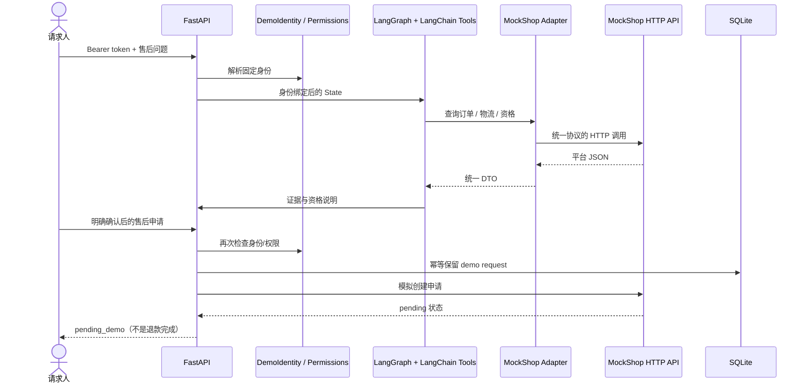

# V2.1 电商售后 Agent 面试讲解

所有示例均基于本仓库的虚构 MockShop；当前没有真实电商平台或真实退款接入。

## 1. 为什么要 Integration Layer？

平台 API 有不同字段、状态码、认证和错误格式。如果业务 Agent 直接依赖这些差异，换平台就要改 Agent。Integration Layer 把网络调用和领域映射集中在 `src/support_agent/integrations/`，让上层只处理 `PlatformOrder`、`LogisticsInfo` 和 `AftersaleEligibility`。

## 2. Adapter Pattern 在哪里？

`ECommerceAdapter` Protocol 定义统一能力；`MockShopAdapter` 调 typed HTTP client 并将平台 DTO 转成统一 DTO。状态映射位于 Adapter 边界。未来新平台可增加 Adapter，但本项目没有实现或声称接入淘宝、京东或 Shopify。

## 3. API 与 Webhook 有什么区别？

API 是 Agent/用户主动查询或申请；Webhook 是平台主动推送事件。查询接口使用 Demo Bearer identity，Webhook 使用原始 body 的 HMAC 签名校验。Webhook 处理写入 `webhook_events` inbox，再按事件时间规则更新 `platform_order_states`。

## 4. 为什么 Agent 不能直接操作电商平台？

模型会误解自然语言或生成错误参数。因此模型只调用绑定后端 `DemoIdentity` 的结构化只读/资格工具；真正写入由独立 API 执行，重做权限、资格和 `confirmed=true` 校验。LangGraph 不暴露 `create_aftersale` 写工具给模型。

## 5. 如何保证订单数据准确？

订单详情来自 MockShop API，经 Pydantic 校验、Adapter 状态映射和后端归属检查；Agent 不允许从 prompt 猜测商品、客户或状态。Webhook 只接受签名正确且 schema 合法的事件，旧事件不会覆盖新状态。测试覆盖已知状态与异常响应；这不等于验证了真实平台数据质量。

## 6. 如何避免重复售后申请？

业务 API 将 tenant 与幂等键纳入 SQLite 唯一约束，主 API 先保留 request，再将同一个受 scope 约束的 key 传给 MockShop。重复调用返回原申请；同 key 不能被用来提交不同业务内容。Webhook 则由 event_id 唯一键去重，相同 ID 不同 payload 会冲突拒绝。

## 7. 如何实现权限控制？

`DemoIdentity` 从 Bearer token 映射 user、tenant 和 role；`permissions.py` 检查 tenant、store、customer。客户端 `X-Tenant-ID` 或 webhook payload 中的 tenant 不参与授权。不可见订单统一返回 404。当前 token 公开且固定，只适用于本地演示，不是真实身份认证。

## 8. Agent 或平台出错怎么办？

Adapter 将 404、权限拒绝、冲突、超时、坏 JSON/Schema 等转换成内部异常类型。API 向用户返回通用错误，日志只记 trace、tenant、平台和 error code 等必要元数据，不写 token、签名或完整 webhook body。失败测试使用 mock transport，不触碰真实数据。

## 9. 如何评估系统？

pytest 的规则/API 用例测权限、字段、幂等和错误边界；35 条 Agent 路由标签与 8 条订单参数单独评估路由/提取；RAG Hit@k 与 Recall@k 衡量证据召回；人工 Bad Case 审阅答案语义；Docker/浏览器验收验证服务组合。每种证据回答不同问题，不能合成单一准确率。

## 请求链路图

