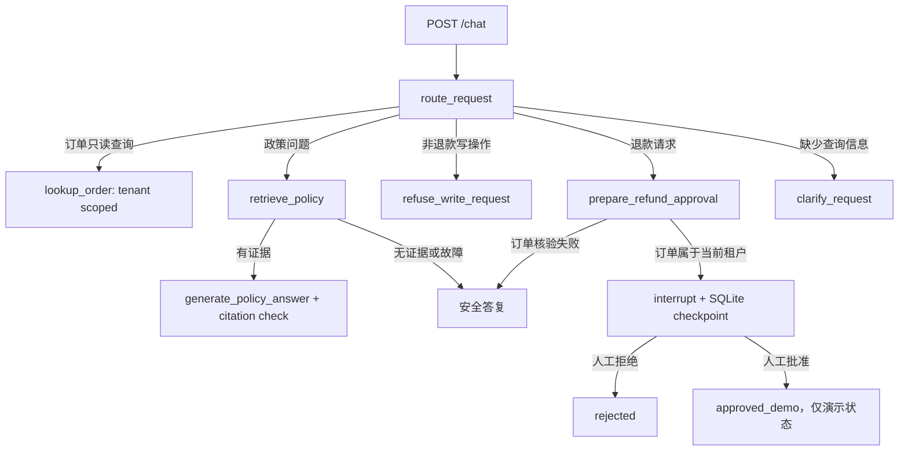

# LangGraph 售后 Agent 设计

## 单轮请求与节点

分类和权限边界由确定性 Python 逻辑执行；LLM 仅用于基于召回证据生成政策答复。订单查询通过 `order_id + tenant_id` 做 SQLite 只读查询。

## State 与持久化

State 保存当前问题、租户范围、意图、订单号、订单或政策证据、回答、引用校验结果、错误类型和审批状态。每个 `/chat` 调用创建独立 thread，不保存多轮对话历史。

退款演示用 LangGraph `interrupt()` 暂停节点并由 SQLite `SqliteSaver` checkpoint 保存状态。人工决定通过 `Command(resume=...)` 恢复。批准只写入 `approved_demo`，不会修改订单、调用退款 API 或声称真实业务已完成。checkpoint 数据库默认位于 `data/checkpoints.sqlite`。

## 路由边界

- `order_lookup`：只读订单状态，按租户过滤。
- `policy_qa`：检索政策，生成受证据约束的回答并核对引用 ID；引用校验不证明回答语义正确。
- `write_request`：拒绝改址、改状态、取消等写操作。
- `approval_required`：退款请求先检查当前租户下订单，再进入纯演示审批暂停。
- `clarify`：缺订单号或缺查询意图时请求补充。

`X-Tenant-ID` 仅为本地演示租户范围参数，不是身份认证。`SqliteSaver` 适用于单机演示，不作为多实例生产部署方案。
