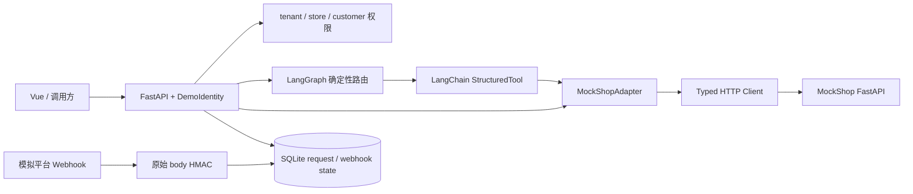

# V2.1 电商 Integration Layer：从 FastAPI 到 MockShop

本章补充五个基础章节之后的扩展主题，直接对应本次实现。平台、客户、订单均为虚构样例。

## 架构位置



## 为什么 Adapter 在 Agent 之前？

Agent 和业务 API 需要稳定的内部结构，不应该知道某个平台叫 `WAIT_BUYER_RECEIVE` 还是 `SHIPPED`。`integrations/mock_shop.py` 负责把平台字段转成 `PlatformOrder` 等 DTO，并把外部错误归一为 `IntegrationError` 子类。`integrations/base.py` 的 Protocol 约束各 Adapter 能提供的能力，`registry.py` 按 platform 选择实现。

```python
order = adapter.get_order(order_id)
if not can_access_order(identity, order):
    raise OrderAccessDenied()
```

这段调用的关键是授权发生在后端；订单号和 tenant 都不能由模型决定访问权限。

## Agent 的工具边界

`integrations/tools.py` 把查询封装成 LangChain `StructuredTool`。构造工具时把当前 `DemoIdentity`、Adapter 和数据库绑定进闭包，所以模型只提供订单号、查询理由等业务参数，不能覆盖身份或 tenant。LangGraph 在 `agent/nodes.py` 中按确定性规则决定调用哪类查询；售后申请写操作由独立 FastAPI endpoint 完成，不开放给模型自动执行。

```text
自然语言问题
  → LangGraph 识别订单 / 物流 / 资格意图
  → 身份绑定的查询 Tool
  → Adapter / typed HTTP client
  → 统一 DTO
  → 安全答复
```

## 售后申请为什么分两步？

1. `GET /ecommerce/orders/{id}/aftersale-eligibility` 只查询资格，不产生副作用。
2. `POST /ecommerce/orders/{id}/aftersales` 再检查 requester、订单范围、资格、`confirmed=true` 和 SQLite 幂等键。
3. 成功返回 `pending_demo`，它只表示模拟平台记录已创建，不等于审核、退货或退款完成。

幂等键将用户重复点击收敛到同一演示申请；SQLite 记录便于审计本地申请状态。平台仍是本地 MockShop，不触碰真实业务系统。

## Webhook 和 API 的职责差别

- API 是调用方主动问平台或提交申请，使用服务端绑定的 Demo identity 做权限检查。
- Webhook 是模拟平台主动通知服务端，按**原始请求体**计算 HMAC，再校验 schema。服务器从 `shop_id` 映射 tenant，不采信 payload 中的 tenant。
- `event_id` 唯一约束防重复处理；同 ID 不同 body 返回冲突；过期事件不能覆盖新的订单状态。

## 关键代码地图

| 职责 | 文件 |
|---|---|
| 统一领域 DTO | `src/support_agent/integrations/models.py` |
| Adapter 能力契约和注册 | `integrations/base.py`、`integrations/registry.py` |
| MockShop 字段/状态映射 | `integrations/mock_shop.py` |
| 后端 store/customer 授权 | `integrations/permissions.py` |
| Agent 可用的结构化工具 | `integrations/tools.py` |
| Webhook schema/状态映射 | `integrations/webhooks.py` |
| HTTP API、身份边界和申请确认 | `src/support_agent/main.py` |
| 幂等申请与事件状态 | `src/support_agent/db.py` |

## 你可以亲手验证

部署到 WSL `/opt/project2` 并确认服务 healthy 后，先打开 Swagger `http://localhost:8000/docs`：

1. 用 `demo-a-local-token` 调 `GET /ecommerce/orders/2003`，应返回店铺 A 虚构订单。
2. 同一 token 调 `GET /ecommerce/orders/2006`，应返回 404；切到 `demo-b-local-token` 再调，应返回店铺 B 订单。
3. 对订单 2003 先 GET 售后资格，再 POST 售后申请；确认字段必须是 `true`，结果为 `pending_demo`。
4. 在代码中打开 `tests/test_webhooks.py`，观察签名错误、重复 event_id、payload 冲突和 tenant 隔离测试分别保护什么。

运行脚本 `scripts/verify_v21.sh` 会自动完成同一组业务边界检查。不要对真实平台或真实客户数据照搬这组 Demo token。

## 本阶段需要记住

- Tool calling 不会代替权限模型：工具执行时仍使用服务端身份。
- Adapter 隔离供应商差异；FastAPI/业务规则决定当前用户能做什么。
- 资格通过、申请已记录、人工审批通过、平台退款完成是四种不同状态。
- 单元/API 测试通过不代表容器已部署；当前 WSL 实机结果应在运行新同步脚本后再记录。
