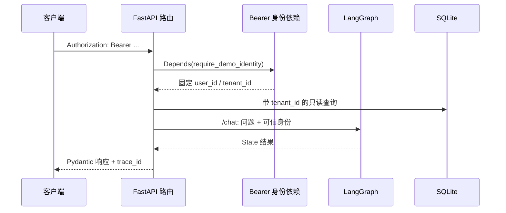

# FastAPI：HTTP API、身份依赖与响应模型

## 在系统中的位置

FastAPI 是外部请求进入项目的边界：校验 JSON、解析演示 Bearer 身份、把可信 tenant/user 传给数据库和 LangGraph，再把内部结果整理成 API 响应。业务路由不直接信任客户端提交的 `tenant_id`。



## 代码映射

- `src/support_agent/main.py`：创建 FastAPI app、lifespan 资源、trace middleware、health/chat/order/approval/run 路由。
- `src/support_agent/auth.py`：HTTP Bearer 解析固定本地演示身份；无 token 或无效 token 返回 401。token 是公开示例值，不是安全凭证。
- `src/support_agent/schemas.py`：Pydantic 请求与响应模型，例如 `ChatRequest` 长度约束、`ChatResponse` 字段、`AgentRunResponse`。
- `src/support_agent/config.py`：读取数据库、checkpoint、模型和演示 token 配置。
- `tests/test_api.py`：通过 FastAPI `TestClient` 验证认证、租户隔离、路由、审批中断/恢复和运行记录范围。

## 请求如何进入 `/chat`

1. Pydantic 先将 body 解析为 `ChatRequest`，限制问题非空且长度不超过 4000。
2. `Depends(require_demo_identity)` 校验 Bearer token，并映射到固定 user/tenant。
3. 路由创建 `run_id` 和 `thread_id`，保存不含原问题明文的最小 run 记录。
4. 把问题、可信身份和追踪信息放进 LangGraph 初始 State。
5. 根据 Graph 输出构造 `ChatResponse`；Pending approval 保持演示状态，错误响应不泄露密钥。
6. Middleware 为请求建立 `trace_id`，记录请求耗时，并将 ID 放进响应头。

## 可运行示例

本机 Docker/API 已启动时，查询虚构订单：

```powershell
curl.exe -H "Authorization: Bearer demo-a-local-token" http://localhost:8000/orders/1001
```

测试 chat 的确定性订单路由：

```powershell
curl.exe -X POST http://localhost:8000/chat `
  -H "Authorization: Bearer demo-a-local-token" `
  -H "Content-Type: application/json" `
  -d '{"question":"查询订单1001"}'
```

Bearer 值是公开演示 token，只能在本地 demo 使用。实际 policy_qa 请求会按配置访问 Embedding/Chat Model 服务；不要用真实个人信息测试，也不要把 `.env` 内容放进命令历史或聊天。

## 必须理解

- Pydantic Schema 是 API 数据契约：校验请求并限制响应形状。
- `Depends()` 将认证等横切逻辑注入路由，避免每条路由重复解析 Authorization。
- 身份/租户必须从可信认证凭证映射；客户端提供的 `X-Tenant-ID` 不能覆盖 token 对应租户。
- 401 表示未认证或凭证无效；404 可避免向其他租户泄露资源是否存在；409 表示审批不在 pending 状态。
- `/health` 是公开健康检查；业务 API 需要 Bearer 演示身份。
- `run_id` 用于最小数据库运行记录，`thread_id` 用于 LangGraph checkpoint 恢复，`trace_id` 串联日志，职责不同。
- HTTP 请求/响应日志应避免原始问题、密钥和个人信息；追踪需要时使用脱敏预览。
- Demo token 固定且公开，不是生产认证；生产化需安全签发、过期/撤销、密钥轮换、角色权限和审计。

## 了解即可

- FastAPI 基于 ASGI，支持异步路由；当前项目很多同步 SQLite/Graph 调用放在普通 `def` 路由中。
- Lifespan 适合启动/关闭数据库 checkpoint 等共享资源。
- OpenAPI/Swagger 由类型注解与 Schema 自动生成，便于本地演示和接口检查。

## 自测题

1. `/chat` 为什么不能把 body 里的 tenant ID 当成授权依据？
2. `Depends(require_demo_identity)` 在路由调用前做什么？
3. Pydantic `Field(min_length=1, max_length=4000)` 帮我们限制什么？
4. 为什么跨租户订单查询返回 404 而不是包含订单状态的响应？
5. `run_id`、`thread_id` 和 `trace_id` 有什么区别？
6. 哪些请求会调用云模型，哪些是确定性本地查询？
7. 为什么公开演示 token 不能被称作生产认证？
8. 中间件 trace ID 对日志排障有什么帮助？
9. API 测试使用 `TestClient` 能覆盖哪些边界？
