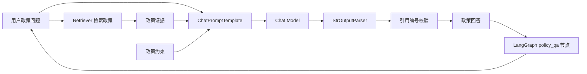

# LangChain：政策问答链路

> 本章从项目现有代码学习。代码入口主要在 `src/support_agent/rag/answer.py`、`retrieval.py`、`index.py`；如果本地身份/运行记录改造改变了调用方式，以当前源代码为准。本章不要求先学完 LangGraph。

## 在系统中的位置

LangChain 提供可组合的模型应用组件：Prompt、Chat Model、Output Parser，以及 RAG 所需的 Embedding、Vector Store 和 Retriever。它负责“把相关政策证据组织成一次回答”；LangGraph 在外层负责选择走订单、政策、澄清还是审批流程。



## 真实代码怎么走

1. `answer_policy_question()` 调用 `retrieve_policies()` 取得 `RetrievedPolicy` 列表。
2. 没有证据时直接返回“无法确认”，不调用模型。
3. `match_answer_constraints()` 按问题和证据得到政策边界；部分强约束可以直接覆盖生成结果。
4. 其他情况把 `ANSWER_PROMPT | chat_model | StrOutputParser()` 组合为 Runnable 链并调用 `invoke()`。
5. 代码检查回答里的政策编号是否都出现在本次检索证据中。该检查验证引用编号归属，不等于证明整段回答语义正确。
6. 外层 `src/support_agent/agent/nodes.py` 的政策节点把 RAG 结果写回 LangGraph State；Graph 再决定后续流程。

索引构建在 `src/support_agent/rag/index.py`：政策文档变成 LangChain `Document`，按项目配置切分、计算向量并存入 Chroma。线上查询时 `retrieval.py` 用向量库检索，不会在每次问答时重新索引全部文档。

## 关键组合：LCEL

```python
chain = ANSWER_PROMPT | chat_model | StrOutputParser()
answer = chain.invoke({
    "question": question,
    "context": context,
    "constraints": constraints_text,
})
```

`|` 把三个 Runnable 串起来：Prompt 将变量变成消息，Chat Model 生成消息，Parser 把消息转成字符串。Runnable 输入输出类型沿链传递。项目选择显式 RAG 链，不把订单权限交给模型工具调用。

## 可运行的小例子

在项目虚拟环境和 `.env` 已配置后，可从项目根目录运行下面的代码，直接调用项目真实政策链：

```powershell
.\.venv\Scripts\python.exe -c "from support_agent.rag.answer import configured_policy_answer; r=configured_policy_answer('退款多久能到账'); print(r.answer); print(r.citations)"
```

此命令会访问配置的 SiliconFlow 模型并发送该演示问题及检索到的政策证据。若只想做离线组件理解，可阅读 `ANSWER_PROMPT`，不必运行云端调用。不要把 `.env` 内容打印或粘贴到聊天中。

## 必须理解

- Prompt 的变量名必须与 `invoke()` 字典键一致。
- 检索证据、政策约束和用户问题是不同输入；约束层能限制答案，但不替代模型质量评估。
- `StrOutputParser` 只转换输出格式，不负责事实核查。
- 引用 ID 检查只验证“引用是否在检索结果里”，不是语义蕴含验证。
- 无证据时应当拒答/说明无法确认；不能让模型凭常识补政策。
- LangChain chain 是单次任务组件；LangGraph 管跨节点业务状态和分支。
- `@tool`/function calling 不是必须项。本项目订单查询由确定性的节点和租户权限保护，不能让模型自行越权调用。

## 了解即可

- LangChain Runnable 也支持批量、流式和异步接口；当前项目主要使用同步 `invoke()`。
- 高级 Agent/tool-calling、回调追踪和并行 Runnable 可在实际需求出现时再学，不为堆技术而引入。

## 自测题

1. `ChatPromptTemplate`、Chat Model、`StrOutputParser` 各自的输入输出是什么？
2. 为什么 `ANSWER_PROMPT | chat_model | StrOutputParser()` 可以用 `invoke()` 一次执行？
3. 为什么无检索证据时项目不应调用模型？
4. 引用编号全部有效，是否代表回答内容一定符合政策？为什么？
5. 政策约束层与 system prompt 的职责有什么差异？
6. Chroma 索引构建与在线 Retriever 查询分别在什么时候运行？
7. 为什么订单权限不适合交给模型判断？
8. 在这个项目中，LangChain 与 LangGraph 的边界在哪里？
