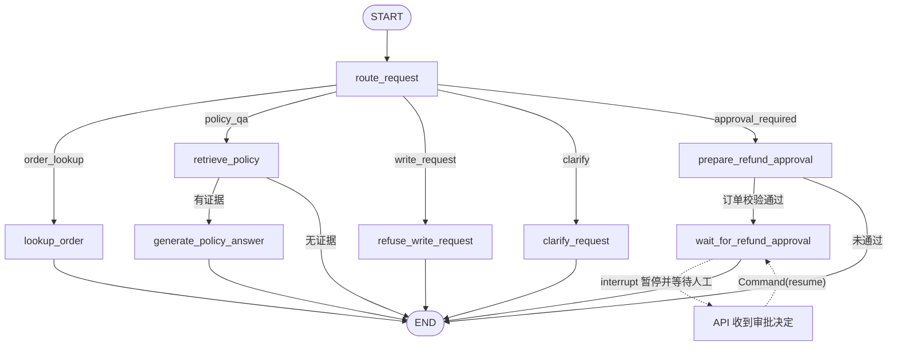

# LangGraph：售后请求状态图

## 在系统中的位置

LangGraph 在 LangChain 链路外层编排完整业务请求。它把一个 `SupportState` 交给节点处理，并根据 State 内容选择下一个节点。政策回答链仍由 LangChain 负责；订单查询和退款审批则是确定性的 Python 节点。

## 本项目的执行图



退款审批只将流程暂停、保存演示审批状态；`approved_demo` 不是退款，也不修改订单。

## 真实代码入口

- `src/support_agent/agent/state.py`：`SupportState` 是跨节点共享的数据结构。字段可选，但本次运行的初始输入由 API 提供，例如问题、用户/租户、订单库路径、`run_id` 和 `trace_id`。
- `src/support_agent/agent/graph.py`：`build_support_graph()` 建立 StateGraph，注册节点，用 `START`、条件边和 `END` 连线，最后 `compile(checkpointer=...)`。
- `src/support_agent/agent/nodes.py`：节点是读取 State 并返回增量更新的函数。例如 `route_request()` 写入 intent，`retrieve_policy()` 写 evidence，`generate_policy_answer()` 写 answer/citations。
- `src/support_agent/main.py`：API 用 `support_graph.invoke(initial_state, config=...)` 启动一次运行；审批 API 用 `Command(resume=...)` 从暂停点恢复。
- `src/support_agent/observability.py`：节点被 `traced_node` 包装，记录开始、结束和耗时。

## State 更新与条件路由

```python
def route_after_retrieval(state: SupportState) -> Literal["generate_policy_answer", "finish"]:
    return "generate_policy_answer" if state.get("evidence") else "finish"
```

这段函数不做检索也不生成答案，只读取已有 State 并返回下一节点名称。图定义把返回值映射到 `generate_policy_answer` 或 `END`。订单、退款、澄清等路由也采取同样模式。

节点更新通常是部分字典，例如 `{"intent": "policy_qa"}`；LangGraph 把更新合并到 State。把证据、租户和运行 ID 显式放在 State 中，可以让后续节点共享所需上下文，而不需要互相直接调用。

## 暂停与恢复

退款节点先校验订单必须属于当前租户。校验成功后，`wait_for_refund_approval()` 调用 `interrupt(...)`，Graph 将执行挂起并由 SQLite checkpointer 保存该线程状态。API 返回待审批；之后只有同租户通过审批端点，才会以同一个 `thread_id` 和 `Command(resume={"approved": ...})` 恢复。

```python
from langgraph.types import Command

# 必须使用暂停时同一个 config/thread_id；示意代码，不要对真实退款调用。
result = graph.invoke(
    Command(resume={"approved": True}),
    config={"configurable": {"thread_id": existing_thread_id}},
)
```

`interrupt()` 所在节点恢复时会从节点入口重新执行，所以暂停前的节点逻辑应保持安全、可重复；不可把真实外部写操作放在 interrupt 之前。此项目中审批恢复只更新演示状态。

## 必须理解

- State 是本次图运行的共享状态；它不是数据库，也不自动代表对话历史。
- Node 执行业务；Edge 表达固定流向；Conditional Edge 根据 State 选择分支。
- `END` 结束当前图运行；有 checkpointer 时，暂停线程状态可以跨 API 请求恢复。
- `thread_id` 标识 checkpoint 线程；`run_id` 是本项目用于 API/数据库运行记录的另一个 ID，不要混为一谈。
- `interrupt` 是暂停点；恢复时通过 `Command(resume=...)` 提供人工决定。
- Graph 状态中的 `tenant_id` 来自 API Bearer token 映射，不应由用户问题或任意 header 决定。
- 权限校验必须在具体数据访问/审批恢复路径执行；不能只依赖自然语言路由正确。
- LangGraph checkpoint 用于流程恢复；它与 `agent_runs` 数据库记录各有用途，后者用于最小运行状态查询。

## 了解即可

- StateGraph 支持 reducer、并行边、子图、流式更新和多种 checkpoint backend；本项目当前采用单轮、串行流程和 SQLite。
- 图可导出可视化，但可视化不是正确性的替代品；核心验收仍需路由/权限/暂停恢复测试。

## 自测题

1. 为什么政策 RAG 同时出现 LangChain 和 LangGraph？各自负责哪一层？
2. `route_request` 写入 `intent` 后，谁决定下一个节点？
3. `route_after_retrieval` 为什么只看 `evidence`？
4. `thread_id` 与 `run_id` 有什么区别？
5. `interrupt()` 之后图如何恢复？
6. 如果暂停节点恢复时会重新执行节点函数，设计节点时要避免什么问题？
7. 订单租户权限应在哪一层检查？为什么不能让 LLM 决定？
8. `agent_runs` 和 SQLite checkpointer 分别保存/解决什么问题？
9. 当前退款演示中“批准”究竟改变什么，又明确不做什么？
