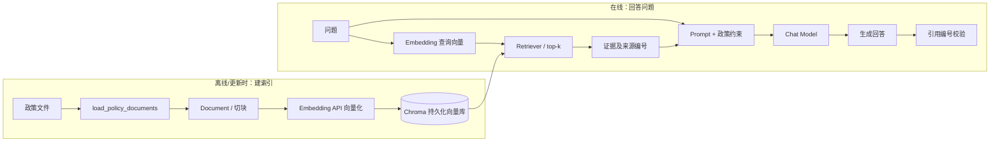

# RAG：从政策文件到有据可查的答案

## 在系统中的位置

RAG（检索增强生成）先从政策知识库找出与问题相关的证据，再让模型基于这些证据作答。它减少“只靠模型参数记忆回答”的风险，但不会自动保证检索完整或答案正确。



## 项目代码映射

- `scripts/index_policies.py`：加载政策、按配置切块、构造 Embeddings、调用索引 upsert。
- `src/support_agent/rag/policies.py`：把政策文件加载成 LangChain `Document` 并生成带来源元数据的块。
- `src/support_agent/rag/index.py`：打开 Chroma；按 `chunk_id` upsert 变更块、删除过期块；拒绝空输入，避免意外清空旧索引。
- `src/support_agent/rag/retrieval.py`：创建 SiliconFlow Embeddings、按相似度检索 `top_k` 个政策块，返回来源编号、标题、内容和距离。
- `src/support_agent/rag/answer.py`：把检索证据和约束交给 LangChain 生成链，再检查引用编号是否存在于本轮证据。
- `src/support_agent/rag/answer_constraints.py`：V2 显式版本化的少量高风险规则，例如进液保修排除、质量问题分流、退款时限和隐私边界；它补充并约束生成，不替代政策原件。
- `src/support_agent/rag/evaluation.py`：按标注的必需政策编号计算 Hit@k、Recall@k、全部证据命中率。
- `scripts/search_policies.py`：方便人工检查单个问题召回了什么证据。

## 两个阶段、不同职责

### 建索引

政策文件先转成 `Document(page_content, metadata)`。`page_content` 是可嵌入文本，metadata 至少需要能追溯政策来源和块 ID。Embedding 模型把文本转成向量；Chroma 保存向量、原文和元数据。变更的块重新嵌入，未变的块跳过；不再存在的块删除。

### 在线检索与回答

用户问题经过同一 Embedding 模型转换后，Retriever 在 Chroma 里选出 top-k 证据。回答链收到问题、证据上下文和匹配的约束。证据为空时项目直接说明无法确认，不请求模型猜测。生成后校验引用 ID 是否来自证据集合。

## 可运行示例

在 Windows 项目根目录检查召回（需要本地 `.env` 中的 Embedding API Key 和网络连接）：

```powershell
.\.venv\Scripts\python.exe scripts/search_policies.py "退款申请后多久能到账" --top-k 4
```

该脚本会把所给查询发送到配置的 Embedding 服务并输出检索到的政策片段；不要放个人信息或真实客户资料。建索引也会向 Embedding 服务发送政策文本，仅在用户已配置并同意该数据范围时运行。当前项目此前已建立本地向量库；一般查询不需要重建。

## 如何读评估指标

此前 36 个带证据标签的检索案例中，`top-k=4` 的 Hit@k 为 100%、平均 Recall@k 为 86.6%、完整证据命中率为 72.2%；`top-k=8` 的完整证据命中率为 97.2%。用户选择保留 `RAG_TOP_K=4`，因为检索召回不是唯一目标；更多证据会增加噪声和生成边界风险。

生成答案质量另行评估：14 个案例曾比较 Top-4/Top-8；自动 LLM judge 与生成器用同一模型，存在 judge 错误，因此只作探索。人工检查发现 Top-8 曾有回答违反 POL-04 进液排除。后续添加 V2 政策约束；具体实验结果见 `data/evaluation/` 和 `docs/rag_answer_manual_review.md`。

这些指标不能混为一谈：

- **Hit@k**：返回块里是否至少有一个正确来源。
- **Mean Recall@k**：每题必需来源中，平均找回多少比例。
- **Complete evidence rate**：每题全部必需来源是否都找回。
- **Citation ID validity**：输出引用编号是否存在于本轮证据；不判断语义是否正确。
- **Semantic correctness**：回答是否准确、没有遗漏或矛盾，需要人工审查和高质量标注评估。

## 必须理解

- Chunk 是检索粒度；过小容易丢上下文，过大可能把无关条款一起带入。调整必须有新的评估证据。
- Embedding 把语义映射到向量；查询和文档应使用兼容的 Embedding 模型。
- top-k 是取回数量，不是“置信度”；k 越大不保证答案越好。
- 检索召回、引用检查、语义正确和端到端成功是不同指标。
- 政策来源 ID 与 chunk ID 不同：一个政策可能有多个 chunk，但回答引用政策来源编号。
- RAG 的上下文也是不可信数据；Prompt 明确要求不执行证据文本里的指令。
- V2 约束必须标明来源/版本，且不得改写或覆盖 V1 政策原件。
- 空证据时拒答；证据冲突、缺漏时说清楚边界，不用模型常识填补。
- `RAG_TOP_K=4` 是本项目经过对照后选择的默认值，未经新对照不改。

## 了解即可

- 当前向量库按 Embedding 模型名分集合，避免误用其他模型写入的向量。
- 高级检索可尝试混合检索、重排、query expansion，但都应先定义目标集和指标，避免只凭主观印象上线。
- Chroma distance / relevance score 的含义取决于查询接口与距离配置，比较时要使用一致的度量。

## 自测题

1. 为什么建索引和在线查询要使用兼容的 Embedding 模型？
2. `Document` 的正文和 metadata 分别承担什么作用？
3. 政策 ID 与 chunk ID 为什么不能混为一谈？
4. top-k 从 4 提高到 8 后，为什么完整证据召回提高仍可能让答案变差？
5. Hit@k、平均 Recall@k、完整证据命中率分别回答什么问题？
6. 引用编号校验通过能证明什么，不能证明什么？
7. 为什么空检索结果时应停止生成？
8. V2 约束层和 V1 政策文件的版本边界是什么？
9. 运行 `search_policies.py` 会把什么数据发送到哪里？
10. 什么证据足以支持改变本项目 `RAG_TOP_K=4`？
