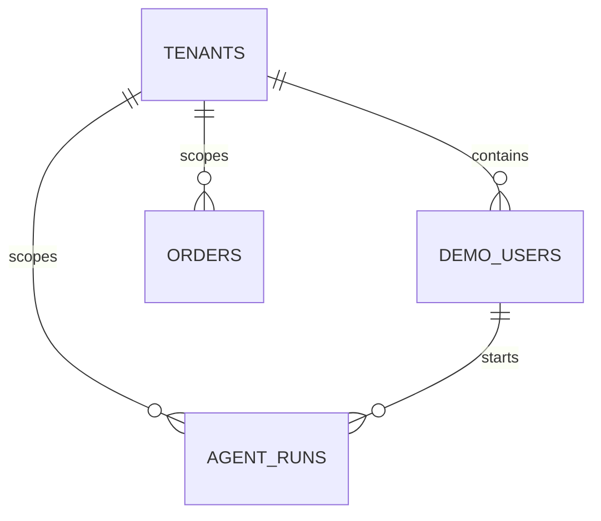

# SQL：SQLite 数据、租户范围与事务

## 在系统中的位置

FastAPI API 和 LangGraph 节点通过 `src/support_agent/db.py` 访问 SQLite。SQL 保存演示租户、订单、固定演示身份与最小 Agent 运行记录；LangGraph checkpoint 则由 LangGraph SQLite saver 管理流程恢复状态。不要把两种持久化职责混为一谈。



## 本项目数据库入口

- `src/support_agent/db.py` 的 `SCHEMA` 定义 `tenants`、`demo_users`、`orders`、`agent_runs`，包括外键、CHECK 约束和租户索引。
- `connect()` 开 SQLite foreign keys 并设置 row factory。
- `initialize_database()` 建表、幂等导入 V1 虚构订单，并添加 V2 演示订单/身份。
- `fetch_order()` 用 `order_id AND tenant_id` 查询，只允许当前租户读取对应演示订单。
- `create_agent_run()` 通过事务插入最小运行记录；不保存完整问题文本。
- `update_agent_run()` 用 `run_id AND tenant_id` 限制状态更新，并验证状态枚举。
- `fetch_agent_run()` 与 `delete_agent_run()` 也进行租户范围过滤；删除仅供测试/演示清理，未暴露为 API。

## 参数化查询与租户过滤

```python
row = connection.execute(
    "SELECT * FROM orders WHERE order_id = ? AND tenant_id = ?",
    (order_id, tenant_id),
).fetchone()
```

`?` 占位符将数据作为参数绑定，避免把用户输入拼进 SQL 语句。`tenant_id` 同样必须参与查询条件；仅在 URL 或前端检查租户不够。项目由 Bearer 演示 token 映射出身份与租户，调用 `fetch_order()` 时传入该租户。

## 事务与资源释放

项目写操作采用 `with closing(connect(path)) as connection:` 管理连接，并使用 `with connection:` 作为事务上下文：正常退出则提交，抛出异常则回滚；外层 `closing` 负责关闭连接。数据库初始化和演示运行记录写入都采用这个模式。

```python
with closing(connect(database_path)) as connection:
    with connection:  # 事务边界
        connection.execute(
            "INSERT INTO ... VALUES (?, ?)",
            (value_a, value_b),
        )
```

上面是事务形状示例，不能直接替换成对订单的真实写操作。项目订单业务刻意只读；审批批准只改演示记录状态，不执行退款或修改订单。

## 可运行示例

已配置本地 `.env` 后，可用公开演示 token 读取本地虚构订单：

```powershell
curl.exe -H "Authorization: Bearer demo-a-local-token" http://localhost:8000/orders/1001
```

用另一个演示租户访问该订单应得到 404。此示例调用本机服务，不会把订单问题发送到云模型。

## 必须理解

- 主键唯一标识一行；外键约束关联表并保护引用一致性；索引提高常见筛选条件的查询效率。
- 租户隔离应落在数据库查询条件中：`WHERE run_id = ? AND tenant_id = ?`。
- 先参数化 SQL，再绑定输入值；不要用 f-string 拼用户提供的 SQL 值。
- 事务把相关写操作组成原子单元：成功一起提交，异常一起回滚。
- `agent_runs` 有状态 CHECK 约束，Python 更新逻辑还做允许值检查，形成两层防护。
- 订单只读边界仍然有效；测试清理函数不是面向用户开放的 CRUD 接口。
- SQL 查询权限与身份认证彼此配合：token 决定可信 tenant，SQL 再强制限定 tenant。
- 完整聊天问题不应无目的持久化；运行记录只保存排障/追踪需要的元数据。

## 了解即可

- SQLite 是单文件数据库，适合本地演示，不代表适合多副本生产服务。
- `timeout=5` 减少并发写锁立即失败的机会；这不是完整重试/韧性方案。
- 本项目用 JSON seed 从旧版导入演示数据；真实系统会使用迁移工具、备份策略和数据保留规则。

## 自测题

1. 为什么 `fetch_order()` 的 WHERE 条件同时包含订单号和租户 ID？
2. SQL 参数化解决什么问题？它能替代身份认证吗？
3. `with connection:` 和 `closing()` 分别管理什么？
4. CHECK、外键和索引各解决什么问题？
5. Agent run 查询为何也必须带 tenant 条件？
6. 为什么演示清理函数没有暴露为 API？
7. `agent_runs` 与 LangGraph SQLite checkpoint 有什么不同？
8. 订单只读边界下，退款审批“批准”允许写入什么、不允许写入什么？
9. 如果记录了用户问题明文，会增加哪些隐私和留存风险？
