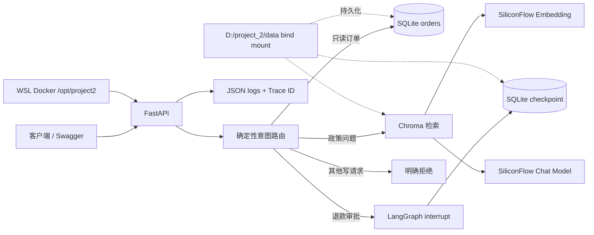

# 项目讲解提纲：Enterprise Support Agent V2

## 项目定位与协作方式

这是我从 Dify 低代码 Agent 项目转向 Python 代码级 Agent 工程的第二个项目。重点是通过一个完整的售后业务场景理解请求、数据、检索、状态编排、评估和部署如何连接，而不是展示技术组件数量。Codex 作为技术负责人完成必要架构和主力开发；我通过项目代码、中文学习材料、运行观察、测试结果和面试练习掌握关键实现与取舍。项目使用虚构数据，只做演示，不提供真实售后服务或退款。

## 一句话介绍

这是我从 Dify 低代码 Agent 开发转向 Python 代码级 Agent 工程的学习项目：用虚构售后场景串起 FastAPI 请求、SQLite 订单查询、LangChain 政策 RAG、LangGraph 流程状态、评估追踪和 Docker 部署。系统不执行真实订单写操作；Codex 负责技术方案与主力实现，我通过代码讲解、学习材料和运行/评估结果掌握关键概念与取舍。

## 系统架构

Agent 节点和 State 细节见 [`langgraph_design.md`](langgraph_design.md)，容器运行步骤见 [`demo_runbook.md`](demo_runbook.md)。

## 关键工程决策

| 问题 | 选择 | 原因与边界 |
|---|---|---|
| 谁决定权限和路由 | 确定性 Python 路由；SQL 订单查询同时约束 order ID 和 tenant ID | LLM 不承担授权判断；`X-Tenant-ID` 只是演示租户选择，不是真实身份认证 |
| 如何回答售后政策 | 单政策文件一个检索块，Chroma 持久存储，Top-4 检索 | 当前政策短且完整上下文重要；引用编号校验只验证来源存在，不保证语义完全正确 |
| 如何处理中断式人工审批 | LangGraph `interrupt()` + SQLite checkpoint | 可展示暂停、批准/拒绝和重启恢复；批准仅记录 `approved_demo`，不调用退款服务 |
| 如何定位运行步骤 | HTTP `X-Trace-ID`、JSON 结构日志 | 关联 API 和节点耗时；输入以脱敏限长预览记录，不记录模型答复或凭据 |
| 为什么 Docker 从 WSL `/opt/project2` 构建 | 避开 `/mnt/d` 上遇到的 BuildKit 权限问题；数据通过 `/mnt/d/project_2/data:/app/data` 绑定到 D 盘 | 构建副本与 Windows 项目需同步；容器内相对数据路径按 `/app` 工作目录解析 |

## 可复述的验证结果

- WSL Docker 容器状态 `healthy`，`/health` 返回 200。
- 订单查询、中文紧邻订单号输入“查询订单1001”、租户隔离均已验收。
- 退款请求可暂停为 `pending`；演示批准恢复为 `approved_demo`，订单状态保持不变。
- 政策问答真实端到端返回 POL-06 引用，`citations_valid=True`。
- 用户在最终容器验收中确认节点耗时、订单/RAG/审批轨迹符合预期，日志没有 `ERROR`；当前本地回归 47 项通过。容器构建时早前 pytest 记录为 35 passed。
- RAG 检索基线：36 条带 `required_evidence` 标签的案例参与评分（全量 45 条中 9 条无该标签）；Hit@4 100%、平均 Recall@4 86.6%、完整召回所有标注证据的比例 72.2%。Hit@4 仅表示至少找到一份期望证据。
- 确定性 no-write 路由子集 4/4 通过；它不是完整 Agent 成功率，也不是 LLM 语义评测。
- Agent 路由标签 35/35、标注订单参数 8/8、模拟 SQLite 工具调用 9/9、标注结果 6/6、预期订单字段 5/5；数据库查询前后保持不变。修复前路由为 30/35。
- 上述最新路由加固在本机 47 项回归中通过；此前容器的最终追踪验收不包含本轮新增的多/非法订单号、隐私索取和提示注入分支，需重建后确认容器版本。

## 约一分钟讲解

> 我把现有售后知识库和模拟订单迁移到一个可运行的 FastAPI + LangGraph 服务。入口先由确定性逻辑判断订单查询、政策问答和写操作；订单查询在 SQL 层按租户过滤，政策问题走 SiliconFlow Embedding、Chroma 检索和受证据约束的模型回答。退款请求通过 LangGraph interrupt 暂停并存到 SQLite checkpoint，人工决定后可恢复，但批准只用于演示，不会改订单或发起真实退款。我用原有 45 条评估规格建立检索基线，对 36 条有证据标签的用例得到 Hit@4 100%、平均 Recall@4 86.6%；完整多证据召回率是 72.2%，因此我保留了 POL-10 等漏召回案例，没有把单一 Hit 指标说成全部正确。最后在 WSL Docker 中完成健康、订单、审批和政策问答验收。

## 面试追问准备

**为什么不用 LLM 判断是否有权限？**

权限是后端确定性边界。模型可能误解意图或受提示注入影响，因此租户 ID 由 API 请求上下文注入，SQL 查询固定带租户条件；写操作不通过模型工具执行。

**`citations_valid=True` 是否表示答案一定正确？**

不是。它只说明回答引用的政策编号属于本次检索证据。语义是否被证据支持，要用事实级评估或人工审核。当前检索评估还显示部分用例只找到多份必要证据中的一部分。

**为什么增加人工审批后仍然说系统只读？**

审批演示只是把 graph 状态从 `pending` 恢复到 `approved_demo` 或 `rejected`。代码没有退款写工具，批准前后订单数据库不变。

**当前方案离生产还差什么？**

至少还需真实身份认证和审批人授权、生产级 checkpoint/数据库与并发控制、语义 grounding 评估、检索漏召回修复、限流/超时/重试策略和安全监控。当前 `X-Tenant-ID` 与 SQLite checkpoint 仅用于单机演示。

## 已知限制

- RAG 尚有 POL-10 等多证据漏召回；没有通过提高 Top-K 后的对照结果，也未加入 reranker。
- 没有完整 LLM-as-a-judge 或语义 grounding 自动评测。
- 租户 Header 不等同身份认证，演示退款审批接口没有审批人认证。
- SQLite checkpoint 和当前容器部署是单机演示方案，不代表高可用生产架构。
