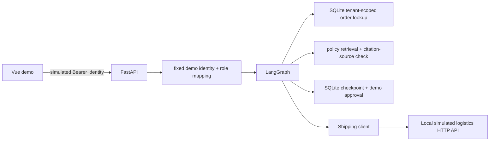

# V2.1 Demo Engineering Reinforcement Plan

## Scope

This plan improves the local learning/demo project only. It does not make the service production-ready. Use fictional tenants, users, orders, approval actions, and a simulated logistics API. Do not use real customer data, connect a commercial courier API, add a real identity provider, migrate to a production database, or perform real refunds.

## Architecture to demonstrate

The demo token is a public, fixed identity selector. Roles and ownership checks demonstrate application authorization flow; they are not authentication against real users.

## Stage 1 — Delivery consistency

- Reconcile README, demo runbook, learning/interview materials, and status claims with files and current test evidence.
- Extend GitHub Actions path filters to include seed/policy data and frontend files; build the frontend in CI when its source or lockfile changes.
- Add a checked-in Python dependency lock and make CI/container installation use it without changing the already-verified dependency set unnecessarily.
- Preserve before/after Bad Case evidence and state what each metric does and does not prove.

Acceptance: clean lock-based install; Python tests and Vue build pass; changing a policy, seed, or frontend file triggers the relevant CI job; docs accurately distinguish citations, evidence support, and semantic correctness.

## Stage 2 — Demo approval identity boundary

- Keep a requester persona and add a separate fictional approver persona within the same tenant.
- Require the approver role for the decision endpoint; preserve tenant checks and return a non-disclosing 404 for another tenant.
- Store requester identity in the checkpoint and record the approver identity in a minimal demo audit event.
- Keep the approval effect limited to `approved_demo` / `rejected`; never change the order or call a refund service.
- Explain that public demo tokens are not credentials and must not protect real or externally exposed data.

Acceptance: requester cannot decide; approver in the same tenant can decide; another tenant cannot inspect or decide; duplicate decisions fail; order data stays unchanged.

## Stage 3 — Simulated external business API

- Add a small local logistics HTTP simulator with fictional tracking records.
- Add a typed HTTP client that sends a tracking/order identifier and the mock auth header, parses JSON, maps provider status into a stable internal response, and handles timeout, connection errors, non-success status, and malformed JSON.
- Add a LangGraph logistics intent/node and expose the structured result in the API/UI.
- Use local service wiring for the demo and mock transports for unit tests. Never call a commercial courier endpoint.

Acceptance: a logistics question follows LangGraph → shipping client → local mock HTTP API → JSON mapping; tenant/order validation happens before the outbound call; timeout and malformed responses return safe, observable outcomes.

## Stage 4 — Demo and interview handoff

- Add a clearly marked simulated approver persona and shipping result view to Vue.
- Update README and runbook with the local start/stop commands and synthetic data notice.
- Update the project story and interview answers with the external API adapter flow, authorization limits, and migration discussion.
- Describe future migration steps in documentation only; do not implement production infrastructure.

## Current progress

- Stage 1 implementation is complete: `uv.lock`, CI `--locked` consistency check, Dockerfile `--frozen` lock install, CI triggers for policy/seed/frontend/scripts/docs, Vue build job, and documented 30/35 → 35/35 route evidence. `uv sync --locked --extra dev`, 65 Python tests, and Vue build have passed locally.
- Stage 2 implementation is complete locally: fixed requester/approver personas, unique-token check, same-tenant approver authorization, requester/self-approval denial, cross-tenant 404, and decision audit fields.
- Stage 3 implementation is complete: LangGraph logistics route, tenant order precheck, typed HTTP client, static mock service, service-key header and tests for timeout, HTTP failure and invalid JSON. User reports both WSL containers healthy and expanded phase 6 + V2.1 verifier passed.
- Stage 4 docs/UI are updated locally: README, runbook, project story, interview kit, LangGraph/FastAPI learning chapters, Vue role selector and fictional tracking display.
- A local Docker image build attempt returned `unexpected EOF` while pulling; the later user-reported WSL rebuild and verifier success supersede that local attempt. Per project instructions, do not build from the Windows-mounted checkout.
- Dockerfile uses `uv sync --frozen` twice to install from the committed lock without re-resolving against Aliyun index metadata. CI intentionally keeps `uv sync --locked` as a stale-lock check.
- Existing worktree changes were preserved. The user has authorized committing and pushing the reviewed V2.1 delivery, including the Dockerfile `--frozen` adjustment.
- Prior confirmed constraints remain: SQLite demo persistence, WSL Docker runtime, D-drive data mount, public repository, and no real provider/customer data for this task.
