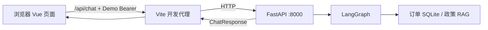

# Vue 本地演示前端

## 作用

Vue 3 + Vite 前端通过现有 FastAPI 接口演示售后对话。浏览器访问同源 `/api`，Vite 开发服务器转发到本地 API；SiliconFlow Key 留在后端环境。



## 本地启动

先确保后端已运行，再打开另一个终端：

```powershell
cd D:\project_2\frontend
npm install --legacy-peer-deps
npm run dev
```

浏览器访问 <http://127.0.0.1:5173>。Vite 默认将 `/api/*` 代理至 `http://127.0.0.1:8000/*`。若后端监听其他地址，可设置 `VITE_API_TARGET`。

## 页面能力与边界

- `/chat` 对话，显示意图、答复、订单卡片、政策引用和可展开证据。
- `approval_status=pending` 时显示批准/拒绝按钮，调用 `/approvals/{thread_id}/decision`。批准只记录 `approved_demo`，不执行真实退款。
- 请求人和审批人拥有独立的前端对话历史；切换角色后显示该角色自己的对话。待审批任务数据跨角色保留，但任务卡和批准/拒绝按钮只显示在审批人页面；请求人只在自己的对话中看到等待审批状态。审批完成后请求人历史中的状态也会更新。
- 审批人当前没有待办时，空状态会提示先由请求人提交带订单号的退款申请；`帮我申请订单1001退款` 是可直接尝试的演示表达。
- Bearer 演示令牌可在密码框修改，并保存在浏览器 `localStorage`；它不是生产认证。
- 不在 Vue/Vite 环境变量中配置 SiliconFlow API Key。真实模型请求由 FastAPI 后端发起。

## 验证口径

- 用户报告：依赖安装、开发页面 HTTP 200、`/api/chat` 代理到现有容器并返回真实模型答复。
- 本地构建：`npm run build` 通过（Vite 6.4.6）。构建不会发起模型请求。
